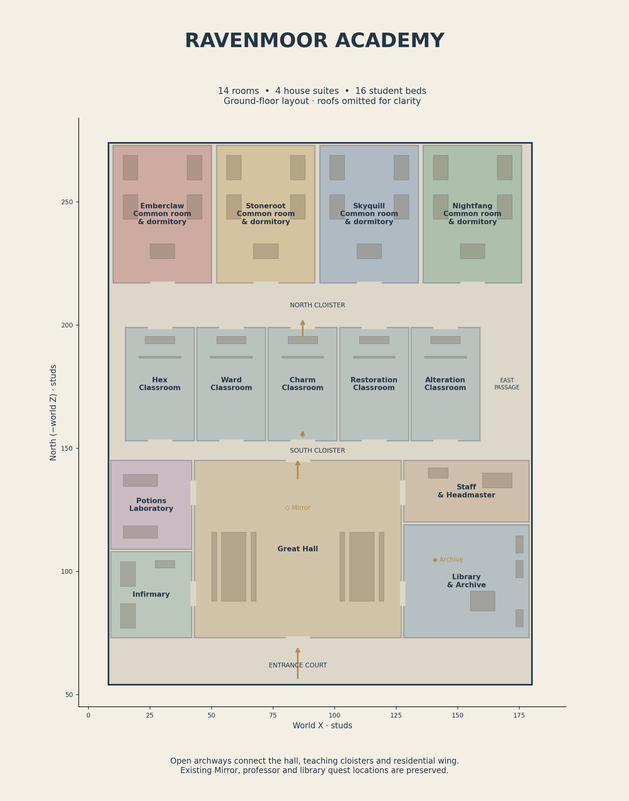

# Expanded Ravenmoor Academy

The academy is an editable, furnished Roblox model, integrated into the supplied game. The main campus foundation is 172 × 218 studs, about 2.2 times the old 144 × 120 courtyard footprint. Slate gable roofs, stone walls, brass trim, house colors and two lantern gate towers retain the academy's fantasy style.




| Room | Design and purpose |
| --- | --- |
| Great Hall | Dining tables, benches, house banners and access to the existing Mirror of Choosing |
| Five classrooms | Hex, Ward, Charm, Restoration and Alteration; blackboards, teacher desks and clear lesson target lanes |
| Library & Archive | Bookshelves, reading table and the existing restricted-shelf interaction |
| Infirmary | Two beds and a treatment table, ready for future healing interactions |
| Potions Laboratory | Two brewing workstations, ready for future crafting interactions |
| Staff & Headmaster | Administrative office and meeting desks |
| Four house suites | Emberclaw, Stoneroot, Skyquill and Nightfang; four beds and a common-room table per house |

All 14 rooms occupy one accessible ground level. Ten-stud-wide open arches, two teaching corridors and an east passage connect the wings. Roof heights are 22 studs in ordinary rooms and 32 in the hall, with raised gables. Beds and furniture are scenery; this change does not add sleeping, infirmary healing or laboratory crafting mechanics. Existing lessons, library actions and sorting continue at their original coordinates.

## Files and editing

- `Wandbound-Ravenmoor-Academy.rbxlx`: full game with the academy already installed.
- `world/RavenmoorAcademy.rbxmx`: reusable architecture and furniture model. Insert it into Workspace from a file in Studio. It does not include the game's NPCs, quest markers, Mirror prop or services; these remain in their existing map groups in the full game. Avoid inserting a second copy into the supplied place.
- `tools/academy.py`: room layouts and geometry generator.
- `tools/upgrade_academy.py`: rebuilds only the academy, exports the model, and prepares `world/Map.rbxmx` using surrounding geometry from the current place. Replaces the Academy, Classrooms and Library groups; preserve manual edits to those groups before running.

After closing the place in Studio:

```bash
python3 tools/upgrade_academy.py
python3 tools/sync_scripts.py --map
python3 tools/validate.py
```

The map sync creates a `.rbxlx.bak` backup. The normal `tools/build.py` full rebuild also uses the new academy design, but regenerates the entire world. Preview images can be refreshed with `python3 tools/preview_academy.py` (optional Matplotlib dependency).

## Validation and remaining playtests

The model contains 426 parts; the world contains 1,998, up from 1,740. Separate limits of 450 academy parts and 2,100 total map parts keep expansion bounded. Geometry checks flood the floor with a 2.5-stud-wide, 5.5-stud-tall player envelope and verify routes to every room, the Mirror, library and all five professors. Existing classroom target clearance and gameplay tests also pass.

Roblox Studio checks remain necessary: walk every doorway, test indoor camera behavior and room lighting at night, finish a professor's lesson in each classroom, use the Mirror and library, and profile a mobile device. The previews are geometry renders, not screenshots from Roblox Studio.
