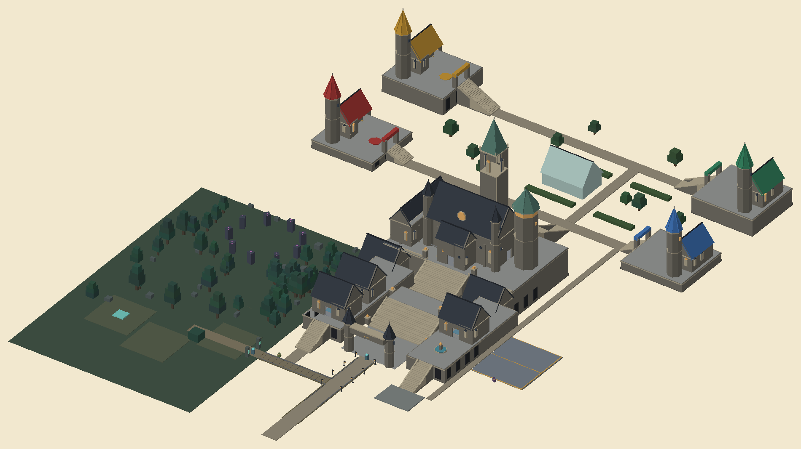
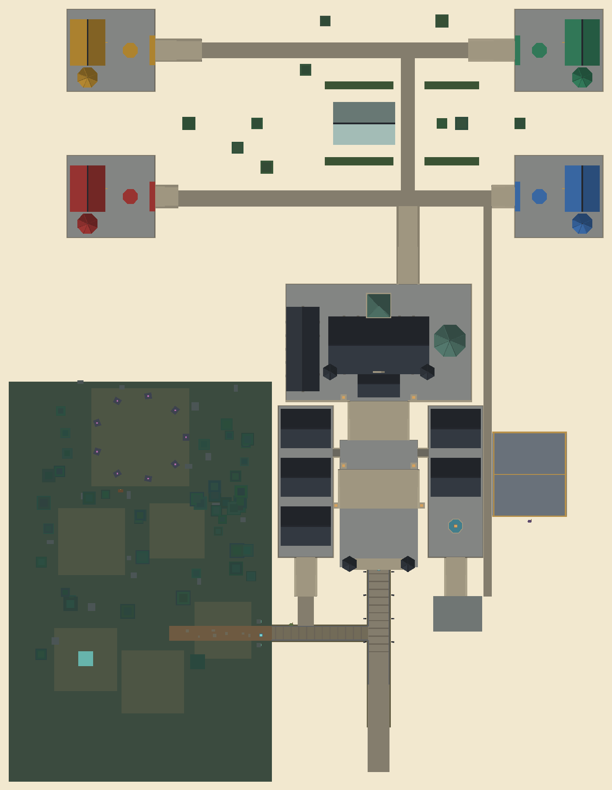

# Ravenmoor Academy campus

The academy is built from the exterior concept canvas, [Academy Exterior Remodel](https://claude.ai/artifact/9WsYqy3tTPN4NaBVxsGduk), fitted to this map. It is bigger and more open than the old single-block castle. The campus climbs three levels on terraces joined by large stairs, every classroom is its own hall, and each house has a separate walled quarter. It is about 550 × 570 studs, against the old 172 × 218 footprint. Everything is plain parts and wedges in the build kit's stone, limestone, slate and copper.





## Layout, south to north

| Level | Place | What is there |
| --- | --- | --- |
| Ground | Arrival plaza | 80 × 60 studs where the approach road ends, behind the Main Gate's two towers. The Castle Waystone stays at the gate. |
| 0 → 20 | Grand Stair, flight one | 20 steps, 80 studs wide, with sloped string walls and lantern pylons. |
| 20 | Landing | 80 × 30 studs. Bridges run west and east to the classroom wings. |
| 20 | Classroom wings | Two 56 × 155 terraces. West: Hex, Ward and Charm. East: Restoration and Alteration, and a fountain court. Each hall is 48 × 36 with open ground on every side. A wing stair drops from each wing's south end. |
| 20 → 40 | Grand Stair, flight two | 20 steps, 60 studs wide, up to the upper terrace. |
| 40 | Upper terrace | 190 × 120 studs. Entrance Keep, Great Hall (100 × 55, with the Mirror of Choosing), Library & Archive (restricted shelf), two hall turrets, the Rookery Tower (about 207 studs to the finial) and the Starwatch Tower with its glazed lantern. |
| 40 → 0 | Back stair | 40 steps down the terrace's north face to the gardens. |
| Ground | North gardens | Two avenues, the garden walk, a glasshouse, hedges and trees. |
| 12 or 24 | House quarters | One 90 × 84 walled terrace per house: Emberclaw and Stoneroot to the west, Skyquill and Nightfang to the east. Each has a common room hall roofed in the house colour, a dorm tower with a house-colour spire, a gate, an emblem in its court, and its own stair down to an avenue. The nearest two quarters are 150 studs apart. |

Every stair uses a 1-stud rise and a 2-stud run. An east walk runs from the training yard along the duel arena to the north gardens, and a path joins the west wing stair to the forest path. About one window in three is a `Lit window`, as are the pylon and fountain lanterns. WorldService switches those from Glass to Neon between 18:30 and 06:00.

## What moved

| Anchor | Was | Now |
| --- | --- | --- |
| Mirror | (85, 3, −125) | (85, 43, −292), Great Hall |
| Library | (146, 3, −104) | (9, 43, −268), Library & Archive |
| Teacher_Hex / Ward / Charm | (29 / 58 / 87, 3, −180) | (10, 23, −201 / −151 / −101), west wing |
| Teacher_Restoration / Alteration | (116 / 145, 3, −180) | (164, 23, −201 / −151), east wing |
| Duelmaster | (190, 3, −86) | (240, 3, −94), south of the arena |

The meadow and world boundary now run north to z −650, and `Config.WorldBounds` lets players walk there. The Castle zone in `Config.Zones` covers the terraces and the house quarters as two rectangles, without taking in any of Whisperwood.

The old interiors are gone: infirmary, potions laboratory, staff office, dining tables and dormitory beds. Halls are built as exteriors with floors, doors and windows, and keep only what gameplay needs: the Mirror, blackboards and spell lanes in each classroom, and the restricted shelf.

## Files and editing

- `tools/academy.py`: the campus layout (`PLAZA`, `WINGS`, `UPPER`, `ROOMS`, `QUARTERS`) and its builders.
- `tools/upgrade_academy.py`: regenerates the campus, plus the Land, Academy staff and Mirror groups it touches, and keeps every other map group from the place. It also writes `world/Markers.rbxmx` and `src/shared/WorldPoints.lua`.
- `tools/preview_academy.py`: redraws the two images above from `world/Map.rbxmx` (needs Pillow). These are geometry renders, not Studio screenshots.
- `world/RavenmoorAcademy.rbxmx`: the campus on its own. The full game already contains it; don't insert a second copy.

After closing the place in Studio:

```bash
python tools/upgrade_academy.py
python tools/sync_scripts.py --map
python tools/validate.py
```

`--map` now replaces both `Workspace/Map` and `Workspace/Markers`, writing a `.rbxlx.bak` copy first. Gables, spires, window heads and stair string walls are WedgeParts. `WEDGE_FLIP` in `tools/academy.py` must match `ROOF_FLIP` in `tools/build.py`. If Studio shows them notched or sloping the wrong way, flip both.

## Where the build differs from the concept

- **Scale.** The concept site is 1,080 × 930 studs, bigger than this whole map. The build keeps its plan and levels and shrinks distances to fit beside the village, Whisperwood and the duel arena.
- **Names and rooms.** Houses use the game's own: Emberclaw, Stoneroot, Skyquill and Nightfang. Five classrooms, one per school in the game, instead of the concept's six.
- **Stairs.** A 1-stud rise and 2-stud run instead of the concept's 2 and 4: the same slope, in steps every Roblox avatar can walk.
- **Grounds.** The existing Mirrorlake and Dueling Club stand in for the concept's lake and dueling ground.

## Validation and remaining playtests

The campus has 1,491 parts (budget 1,600) and the map 3,063 (budget 3,300). The walking check floods every level with a 2.5-stud-wide, 5.5-stud-tall player that climbs at most 1.15 studs per step. It confirms routes from the arrival plaza up the stairs to all 11 halls, the 4 house courts, the Mirror, the library shelf and all five professors. The classroom target-clearance check also passes. Removing the stair steps makes the walking check fail.

Still to check in Roblox Studio: walk every stair at normal speed, check the wedge string walls, gables and spires, try the camera in the halls and on the bridges, light the windows at night, finish a lesson in each classroom, use the Mirror and the library, start a duel from the Duelmaster's new spot, and profile on a phone.
